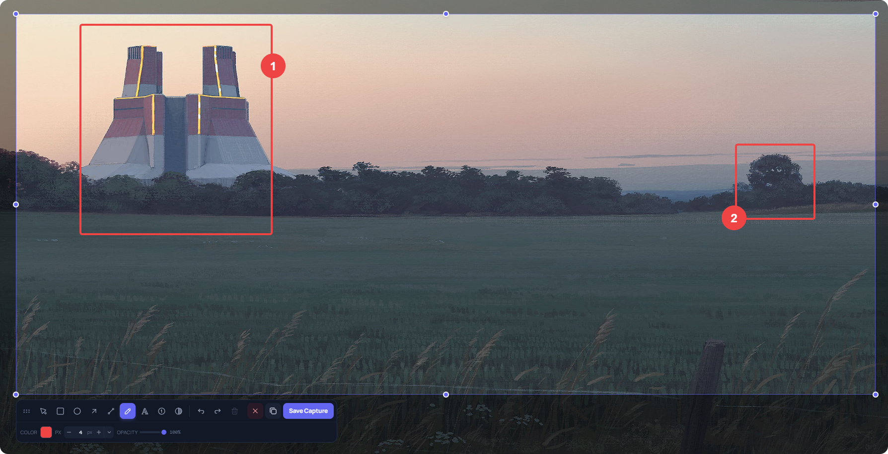

# prin

Fast, minimal, in-place screen capture and annotation tool for **Windows** and **macOS** — built with Tauri 2, React 19, and Konva.



## Overview

`prin` is designed around a single goal: get from pressing a shortcut to having an annotated screenshot on your clipboard in as few milliseconds and keystrokes as possible.

- **Instant invocation**: A pre-warmed overlay window and reusable GPU/desktop capture pipeline keep the transition from shortcut press to region selection near-instant.
- **In-place editing**: Select a region on any monitor and annotate directly over the frozen screen — no separate editor window, no context switch.
- **Non-destructive vector annotations**: Every shape, stroke, text block, step counter, and blur region remains editable, movable, and resizable until you copy or save.
- **Zero background footprint**: `prin` stores no screenshot gallery or persistent history. As soon as you copy, save, or cancel, all image buffers and canvas layers are released.
- **Bilingual UI**: Full support for **English (`en`)** and **Brazilian Portuguese (`pt-BR`)**, with automatic OS locale detection and instant switching in Settings.

## Features

- **Annotation Tools**:
  - **Select (`V`)**: Move, resize, rotate, duplicate, or restyle any existing annotation.
  - **Rectangle (`R`)** & **Ellipse (`O`)**: Crisp vector shapes with adjustable stroke width, corner radius, and **Spotlight mode** (dims the area outside the shape to highlight key regions).
  - **Arrow (`A`)** & **Line (`L`)**: Clean directional pointers and lines.
  - **Pen (`P`)**: Freehand drawing with smooth stroke rendering; selection handles stay hidden while drawing and appear only after releasing the pointer.
  - **Text (`T`)**: In-place multi-line text editor with customizable font size and color.
  - **Step Counter (`N`)**: Auto-incrementing numbered badges (`1`, `2`, `3`…) for step-by-step guides.
  - **Blur / Pixelate (`B`)**: True pixel redaction that filters the underlying capture data with adjustable intensity.
- **Live Region Reframing**: Eight resize handles around the active selection let you expand or crop the captured area at any time without losing existing annotations.
- **Multi-Monitor & HiDPI / Retina Ready**: Captures across all connected displays in physical pixels (including negative monitor coordinates) and renders annotations at native display resolution.

## Architecture

**Rust handles operating system integration and capture; React + Konva handle the interactive canvas.**

```text
src-tauri/src/
  capture.rs        Multi-monitor capture and virtual-desktop composition
  dxgi_capture.rs   Reusable DXGI Desktop Duplication session (Windows fullscreen/GPU)
  lib.rs            Window orchestration, global shortcut, system tray, and IPC handoff

src/
  types/            Domain model (annotations, styles, tools)
  store/            Scene state and undo/redo history (Zustand)
  i18n/             English (en) and Brazilian Portuguese (pt-BR) localization
  components/
    canvas/         Konva stage, vector shapes, pixel blur, in-place text editor
    panels/         Floating contextual toolbar
    controls/       Color palette and numeric stepper controls
    overlay/        Post-selection region resize handles
  windows/          Launcher, settings, and fullscreen capture overlay
  lib/              Zero-encode region crop, export pipeline, and shortcut formatting
```

### Two Windows, One Bundle

| Window    | Role                                                       |
| --------- | ---------------------------------------------------------- |
| `main`    | Launcher and settings window; resides quietly in the tray  |
| `overlay` | Fullscreen region selection, in-place annotation, and export |

Both windows share a single Vite entry point, routed via the `?window=` query parameter.

### Capture & Lifecycle Pipeline

```text
idle  ──drag──▸  selecting  ──release──▸  annotating
                                               │
                                 copy/save ────┴──▸ hides & frees memory
```

1. **Capture**:
   - **Windows**: Uses a fast GDI capture path for desktop windows and automatically switches to **DXGI Desktop Duplication** when a fullscreen or GPU-exclusive application is active (with cached D3D11 device and staging textures).
   - **macOS**: Captures via native system APIs with automatic Retina (`scale_factor`) backing coordinate translation.
2. **Selection**: Dragging a region crops the full-desktop image into an in-memory canvas synchronously (`< 1ms`), entering annotation mode immediately on pointer release.
3. **Export & Cleanup**: Pressing `Enter` or `Ctrl+C` / `Cmd+C` snapshots the composited stage, immediately hides the overlay so you can return to work, writes the PNG to the system clipboard, and frees all decoded blobs and canvas backing stores.

## Global Shortcut

By default, `prin` registers the first available shortcut from `Ctrl+Shift+X`, `Ctrl+Shift+P`, or `Alt+Shift+S` (and `Cmd+Shift+X` on macOS). You can record any custom key combination in **Settings**.

## Keyboard Shortcuts (During Capture)

| Key | Action |
| --- | ------ |
| `V` `R` `O` `A` `L` `P` `T` `N` `B` | Select tool (Select, Rectangle, Ellipse, Arrow, Line, Pen, Text, Counter, Blur) |
| `Enter` | Deselect active annotation, or copy capture and close when nothing is selected |
| `Ctrl+C` / `Cmd+C` | Copy capture to clipboard and close |
| `Ctrl+S` / `Cmd+S` | Save capture as PNG and close |
| `Ctrl+Z` / `Cmd+Z` | Undo |
| `Ctrl+Shift+Z` / `Cmd+Shift+Z` | Redo |
| `Ctrl+D` / `Cmd+D` | Duplicate selected annotation |
| `Ctrl+A` / `Cmd+A` | Select all annotations |
| `Delete` / `Backspace` | Delete selected annotation |
| `Esc` | Clear active selection; press again to cancel capture |

## Development

```bash
pnpm install
pnpm tauri dev     # Start in development mode
pnpm test          # Run unit tests (Vitest)
pnpm tauri build   # Build production installer (.exe / .msi on Windows, .dmg on macOS)
```

### Requirements
- **Node.js** 18+ and **pnpm**
- **Rust** stable toolchain
- **Windows**: MSVC Build Tools (C++ workload) and WebView2 Runtime
- **macOS**: Xcode Command Line Tools (`xcode-select --install`)

### macOS release signing

The release workflow signs and notarizes macOS `.dmg` files so Gatekeeper can open them. Configure these GitHub Actions repository secrets before publishing a release tag:

- `APPLE_CERTIFICATE`: base64-encoded `.p12` Developer ID Application certificate
- `APPLE_CERTIFICATE_PASSWORD`: password used when exporting that certificate
- `APPLE_SIGNING_IDENTITY`: certificate identity, for example `Developer ID Application: Your Name (TEAMID)`
- `APPLE_ID`: Apple Developer account email
- `APPLE_PASSWORD`: app-specific password for that Apple ID
- `APPLE_TEAM_ID`: Apple Developer team ID

The macOS release jobs stop before building if any of these secrets is missing, preventing unsigned installers from being published.

## License

MIT
